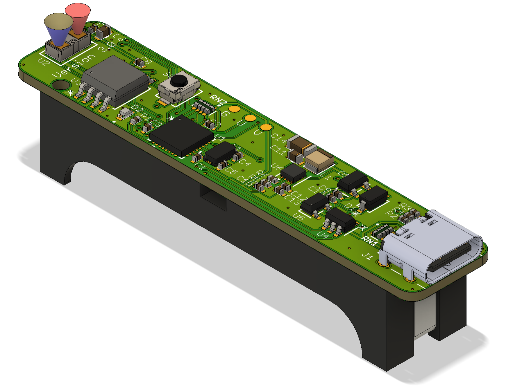

# K-Logger v3 — 扉開閉記録装置

VL53L1X ToF距離センサで扉の開閉を検出し、内蔵フラッシュメモリに記録するデータロガー。
v2 からの主な変更点は以下のとおり（開発中）。

| 項目 | v2 | v3 |
|---|---|---|
| MCU | AVR32DB32 | AVR64DU32（ネイティブUSB） |
| PC通信 | CP2102N（USB-UART、要ドライバ） | USB-CDC（ドライバ不要） |
| 記録媒体 | microSD（FatFs、CSV） | W25Q128 16MB（バイナリ、PCツールでCSV化） |
| 電源 | 単3×1 | 単4×1、USB接続中はUSB給電（自動切替） |
| USB端子 | micro-B | Type-C |
| 電源スイッチ | スライド | なし（ボタン長押しでソフトOFF） |
| 基板CAD | Eagle | Fusion |

旧版（v2）は [v2/](v2/README.md) を参照。



## ディレクトリ構成

```
docs/
  images/               基板・3D外観画像
hardware/
  BOM.xlsx              設計用部品表（JLCPCB部品番号・リンク付き）
  datasheets/           主要部品データシート（ファイル名=参照記号）
  pcb/                  Fusion設計データ(klogger.f3z)、回路図PDF
  fab/                  JLCPCB入稿データ（ガーバー、JLCPCB_BOM.xlsx、JLCPCB_CPL.xlsx）
firmware/klogger.X/     MPLAB X プロジェクト（AVR64DU32, MCC Melody: klogger.mc3）
software/python/        PC側ツール klogger.py（USB-CDC通信、記録開始、データ読出し→CSV）
v2/                     旧版 K-Logger v2 一式（凍結）
```

## バージョン

- 製品世代: K-Logger v3（v2 の後継）
- 基板: 3.0（シルク表記「Version 3.0」）。修正ごとに 3.1, 3.2 … と上げる。リポジトリには最新版のみを置き、過去の版は Git の履歴で参照する
- ファームウェア: 3.0.0 から開始（`hello` 応答の `fw`。`firmware/klogger.X/version.h`）

## 使い方

### 動作モード
| 状態 | 入り方 | 動作 | LED |
|---|---|---|---|
| USB通信 | USBを挿す | PCツールからの操作を受け付ける（USB給電） | 1秒ごとに2回点滅 |
| 記録 | PCツールで `start` | 記録間隔ごとに距離を記録。USBを抜いても続ける | 消灯 |
| 待機（ソフトOFF） | USB無しで電池を入れる / 記録中にボタン5秒長押し / 電池切れ | 何もしない（省電力） | 消灯 |

- ボタンを押している間はLEDが点灯する（生存確認）。5秒長押しでリセット（記録中なら記録停止）。
- 記録中にUSBを挿すと記録を止めてUSB通信モードに戻る（データは保存される）。
- 記録開始時に既存データは消去される。先に `read` で読み出しておくこと。
- 電池を抜くと、まだフラッシュに書いていない最大128件（1秒間隔で約2分）が失われる。

### PCツール（`software/python/klogger.py`）
`pip install pyserial` の後、USBを挿して実行する（COMポートは自動検出）。

```
python klogger.py info              機器情報・状態・電池電圧
python klogger.py start -i 1        時刻合わせ＋記録開始（記録間隔1秒）
python klogger.py read              保存データをCSVに保存（--daily フォルダ でv2互換の日別CSV）
python klogger.py measure           距離を連続表示（保存しない）
python klogger.py calibrate 140     オフセット校正（対象物を140mmに置く）
python klogger.py tof --mode long --tb 33 --roi 8   測距条件の変更
python klogger.py selftest          自己診断
```

### 記録データ形式
1レコード2バイト（W25Q128に連続保存、16MBで約838万件＝1秒間隔で約97日）。
bit15–13が状態コード（0=有効, 1=sigma fail, 2=signal fail, 3=out of bounds, 4=wraparound, 5=min range, 6=その他）、
bit12–0が距離[mm]。0xFFFEは計測失敗。時刻は 記録開始時刻 + index × 記録間隔 で復元する。
